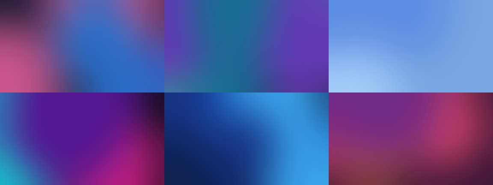

# hyprland-dotfiles

Configuración completa de **Hyprland** con aspecto tipo macOS, 5 temas intercambiables, widgets de escritorio, un **Centro de Control estilo iPhone**, fondos distintos por escritorio, capturas de pantalla estilo GNOME y una terminal con estilo. Se instala con **un solo comando**.

> Hecho para Debian / Ubuntu y derivados (apt) con Hyprland 0.53+.



---

## Contenido

- [Características](#características)
- [Instalación](#instalación)
- [Atajos de teclado](#atajos-de-teclado)
- [Personalización](#personalización)
- [Volver a como estaba](#volver-a-como-estaba)
- [Solución de problemas](#solución-de-problemas)
- [Estructura del proyecto](#estructura-del-proyecto)
- [Créditos](#créditos)

---

## Características

| | |
|---|---|
| 🎨 **5 temas completos** | `macos`, `aurora`, `cielo`, `hacker` (Netrunner) y `windows`. Cada tema cambia la barra, el menú, los bordes, la terminal, las notificaciones, la pantalla de bloqueo y el fondo. |
| 🍎 **Botones estilo Mac** | Cerrar, minimizar y maximizar en cada ventana (plugin *hyprbars*). |
| 📦 **Ventanas minimizadas** | Se guardan aparte y aparecen en la barra con un contador para recuperarlas. |
| 🚀 **Menú de apps tipo GNOME** | Aparece al tocar la tecla **Windows**, a pantalla completa y con caché para abrir rápido. |
| 🖼️ **Fondos por escritorio** | Cada escritorio (1–9) puede tener su propio fondo, con transiciones suaves (*swww*). |
| 🗂️ **Apps por escritorio** | El navegador se abre en el 2, el editor de código en el 3, etc. Configurable. |
| 🧩 **Widgets de escritorio** | Reloj grande, foto redonda, barras de CPU / RAM / temperatura / disco / batería, 4 apps y 4 juegos con iconos en blanco y negro. |
| 🔋 **Batería real** | Muestra cuánto tiempo llevas sin cargador y cuánto se ha descargado (lee el historial de UPower). |
| 📶 **Centro de Control estilo iPhone** | Wi-Fi, Bluetooth, modo avión, brillo, volumen, música y menú de apagado. Va fijo en el escritorio de cada monitor y también se abre como panel grande con la pantalla oscurecida. |
| 📸 **Capturas estilo GNOME** | Área, ventana o pantalla completa. Se guardan en *Imágenes/Capturas de pantalla* y se copian al portapapeles. |
| 🖱️ **Selector de cursor** | Cambia el tema del cursor desde un menú. |
| 💻 **Terminal bonita** | Kitty con colores del tema, prompt *starship*, `eza` con iconos y `fastfetch` al abrir. |
| 👆 **Gestos** | Desliza 3 dedos para cambiar de escritorio. |
| 🔒 **Bloqueo al encender** | Entra directo a la pantalla de bloqueo de Hyprland estilo Mac, con fondo y foto de perfil que tú eliges. |
| 🌙 **Modo oscuro e iconos** | Apps GTK en modo oscuro e iconos Papirus. |

---

## Instalación

```bash
git clone https://github.com/TU-USUARIO/hyprland-dotfiles.git
cd hyprland-dotfiles
bash instalar.sh
```

Después **cierra sesión y vuelve a entrar** a Hyprland.

### Opciones

```bash
bash instalar.sh --tema aurora      # tema inicial: macos | aurora | cielo | hacker | windows
bash instalar.sh --nombre Ana       # nombre del saludo y de la pantalla de bloqueo
bash instalar.sh --bloqueo-al-iniciar  # al encender, directo a la pantalla de bloqueo
bash instalar.sh --sin-paquetes     # solo copia la configuración, no instala programas
```

### Qué hace el instalador

1. Instala con `apt` los programas necesarios, uno por uno. Si alguno no existe en tu distro lo salta y te avisa.
2. **Respalda** tu configuración actual en `~/.config/respaldo-hyprland-FECHA/`.
3. Copia la configuración a `~/.config/hypr` y `~/.config/kitty`.
4. Aplica el tema elegido (por defecto `macos`).
5. Intenta activar el plugin *hyprbars* (botones de ventana).
6. Aplica iconos, modo oscuro y gestos según tu versión de Hyprland.
7. Configura la terminal bonita.

<details>
<summary><b>Programas que instala</b></summary>

`waybar` `wofi` `rofi` `kitty` `mako-notifier` `swww` `swaybg` `hyprlock` `hypridle` `hyprpicker` `grim` `slurp` `wl-clipboard` `swappy` `cliphist` `brightnessctl` `playerctl` `pavucontrol` `network-manager-gnome` `blueman` `bluez` `libnotify-bin` `thunar` `yad` `curl` `imagemagick` `python3-gi` `python3-gi-cairo` `gir1.2-gtk-3.0` `gir1.2-gtklayershell-0.1` `papirus-icon-theme` `gnome-themes-extra` `fonts-inter` `fonts-font-awesome` `fonts-jetbrains-mono` `policykit-1-gnome` `xdg-user-dirs` `wireplumber` `fastfetch` `eza` `btop`

</details>

---

## Atajos de teclado

`Win` = tecla Windows / Super

### General

| Atajo | Acción |
|---|---|
| `Win` (tocar y soltar) | Menú de aplicaciones |
| `Win + Espacio` | Buscador rápido de apps |
| `Win + Enter` | Terminal |
| `Win + T` | Terminal desplegable |
| `Win + E` | Archivos |
| `Win + B` | Navegador |
| `Win + Q` / `Alt + F4` | Cerrar ventana |
| `Win + F` | Pantalla completa |
| `Win + V` | Ventana flotante |
| `Win + C` | Historial del portapapeles |
| `Win + L` | Bloquear |
| `Win + X` | Menú de apagado |
| `Win + Shift + R` | Recargar configuración |
| `Win + Shift + B` | Mostrar / ocultar la barra |

### Ventanas y escritorios

| Atajo | Acción |
|---|---|
| `Win + M` | Minimizar ventana |
| `Win + Shift + M` | Restaurar una minimizada |
| `Win + Ctrl + M` | Restaurar todas |
| `Win + 1…9` | Ir al escritorio |
| `Win + Shift + 1…9` | Mover la ventana a ese escritorio |
| `Win + Tab` / `Win + Shift + Tab` | Escritorio siguiente / anterior |
| `Win + S` | "Bolsillo" (escritorio oculto) |
| `Win + Alt + S` | Mandar ventana al bolsillo |
| `Win + flechas` | Mover el foco |
| `Win + Shift + flechas` | Mover la ventana |
| `Win + Ctrl + flechas` | Redimensionar |
| 3 dedos ← → | Cambiar de escritorio |

### Apariencia

| Atajo | Acción |
|---|---|
| `Win + Alt + T` | Cambiar tema |
| `Win + W` | Elegir el fondo del escritorio actual |
| `Win + Shift + W` | Fondo aleatorio |
| `Win + Alt + W` | Mostrar / ocultar widgets |
| `Win + Alt + F` | Cambiar la foto del widget |
| `Win + Alt + A` | Elegir las 4 apps del widget |
| `Win + Alt + J` | Elegir los 4 juegos del widget |
| `Win + Alt + C` | Cambiar cursor |
| `Win + Alt + L` | Cambiar la imagen de la pantalla de bloqueo |
| `Win + Alt + P` | Cambiar la foto de perfil de la pantalla de bloqueo |

### Capturas

| Atajo | Acción |
|---|---|
| `Impr Pant` / `Win + Shift + S` | Seleccionar área |
| `Alt + Impr Pant` | Ventana |
| `Shift + Impr Pant` | Pantalla completa |

---

## Personalización

### Fondos de pantalla
- Pon tus imágenes en `~/.config/hypr/fondos/` o en `~/Wallpapers/`.
- Usa `Win + W` en cada escritorio para elegirlas, o edita `~/.config/hypr/fondos/escritorios.conf`:
  ```ini
  1=~/.config/hypr/fondos/oceano.jpg
  2=~/Wallpapers/mi-fondo.png
  ```

### Apps por escritorio
Edita `~/.config/hypr/apps-escritorios.conf`:
```ini
firefox, chrom, brave = 2
code, postman = 3
```
Para ver el nombre de una app abierta: `hyprctl clients | grep class`. Después de editar: `pkill -USR1 -f fondos-escritorio.py`.

### Widgets
- **Foto:** clic sobre ella o `Win + Alt + F` (abre una galería con carpetas).
- **Apps y juegos:** clic derecho sobre un icono para cambiarlo, o edita `~/.config/hypr/widget/apps.txt` y `juegos.txt`.
- Después de editar a mano: `Win + Alt + W` dos veces.

### Temas
Cada tema vive en `~/.config/hypr/temas/<nombre>/`. Para crear uno nuevo copia una carpeta, cambia sus colores y elígelo con `Win + Alt + T`.

### Pantalla de bloqueo al encender
Para que al prender la computadora entres directo a la pantalla de bloqueo de Hyprland (en lugar del inicio de sesión de siempre):
```bash
sudo bash ~/.config/hypr/scripts/bloqueo-al-iniciar.sh            # activar
sudo bash ~/.config/hypr/scripts/bloqueo-al-iniciar.sh --quitar   # volver a como estaba
```
Detecta GDM, SDDM, LightDM, greetd o inicio por terminal. Cambia la imagen con `Win + Alt + L` (o `elegir-bloqueo.sh --tema` para usar el fondo del tema).

### Fondo en VS Code (opcional)
```bash
bash ~/.config/hypr/scripts/vscode-fondo-instalar.sh
```

---

## Volver a como estaba

| Qué | Cómo |
|---|---|
| Toda la configuración | Copia de vuelta la carpeta `~/.config/respaldo-hyprland-FECHA/` |
| Iconos, modo oscuro y gestos | `bash ~/.config/hypr/scripts/revertir-mejoras.sh` |
| Terminal | `bash ~/.config/hypr/scripts/terminal-revertir.sh` |

---

## Solución de problemas

| Problema | Solución |
|---|---|
| No veo los cambios | `Win + Shift + R`, o cierra sesión y vuelve a entrar |
| No salen los botones de las ventanas | Dentro de Hyprland: `bash ~/.config/hypr/scripts/instalar-barras.sh` |
| No aparecen los widgets | `bash ~/.config/hypr/scripts/widget.sh` y revisa `~/.config/hypr/widget/registro.log` |
| Una app desapareció | `bash ~/.config/hypr/scripts/rescatar-ventanas.sh` |
| El menú no abre | `bash ~/.config/hypr/scripts/menu-apps.sh` en la terminal para ver el error |
| Falta un programa | `sudo apt install <programa>` y vuelve a ejecutar `bash instalar.sh --sin-paquetes` |

---

## Estructura del proyecto

```
hyprland-dotfiles/
├── instalar.sh               # instalador
├── config/
│   ├── hypr/
│   │   ├── hyprland.conf     # configuración principal y atajos
│   │   ├── apps-escritorios.conf
│   │   ├── fondos/           # fondos y escritorios.conf
│   │   ├── temas/            # macos, aurora, cielo, hacker, windows
│   │   ├── scripts/          # menú, widgets, centro de control, capturas…
│   │   ├── widget/           # fotos, apps.txt, juegos.txt y estilos
│   │   ├── terminal/         # starship y extras de la terminal
│   │   └── vscode/
│   └── kitty/kitty.conf
└── docs/
```

---

## Créditos

- Construido sobre [Hyprland](https://hyprland.org), [Waybar](https://github.com/Alexays/Waybar), [rofi](https://github.com/davatorium/rofi), [wofi](https://hg.sr.ht/~scoopta/wofi), [swww](https://github.com/LGFae/swww), [kitty](https://sw.kovidgoyal.net/kitty/), [starship](https://starship.rs) y [Papirus](https://github.com/PapirusDevelopmentTeam/papirus-icon-theme). Ninguno se incluye en este repositorio; se instalan desde los repositorios de tu distro.
- Los fondos degradados y las fotos de ejemplo del widget se generaron para este proyecto. `ia-1.jpeg` e `ia-2.jpeg` fueron creados con IA.
- Los temas `macos` y `windows` solo imitan el estilo visual. No están afiliados a Apple ni a Microsoft ni usan sus logotipos.
# hyprland444
